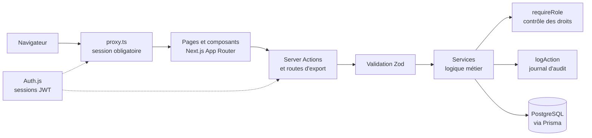
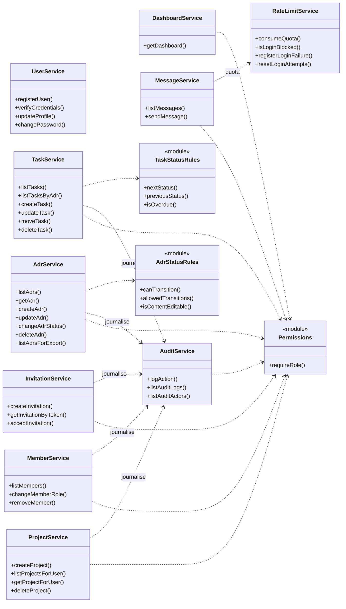

# Architecture de SlamGement

## Vue d'ensemble

Chaque requête traverse les mêmes couches. La règle d'or : les pages et les
actions serveur ne parlent **jamais** directement à la base, elles passent par
un service, et c'est le service qui contrôle les droits et journalise.

## Diagramme de classes de la couche métier

## Modèle de données

Le modèle relationnel est dans `prisma/schema.prisma`. Les tables : `User`,
`Project`, `Membership` (rôle par projet), `Invitation`, `Adr`, `Task`,
`AuditLog`, `RateLimit`, `PasswordResetToken`, `ApiToken`, `Message` (discussion du projet, supprimée avec lui ; l'auteur n'est jamais supprimé, seulement anonymisé).

## Clients et API

Le site (Next.js) et l'application mobile (Expo, `mobile/`) partagent les mêmes services métier. Le site les appelle par Server Actions, le mobile par l'API REST `/api/v1` (jeton révocable). Voir `docs/API.md`.

## Décisions d'architecture (les ADR du projet lui-même)

| Décision                                                                                   | Raison                                                                                                                                                |
| ------------------------------------------------------------------------------------------ | ----------------------------------------------------------------------------------------------------------------------------------------------------- |
| Règles métier dans des modules sans dépendance (`adr-status`, `task-status`)               | Testables seules, réutilisées par l'interface et les services                                                                                         |
| Contrôle des droits dans les services, jamais seulement dans l'interface                   | Cacher un bouton ne protège rien                                                                                                                      |
| Action et trace d'audit dans la même transaction                                           | Jamais de changement sans trace                                                                                                                       |
| Pas d'adaptateur Prisma pour Auth.js, sessions JWT                                         | Notre modèle `User` porte déjà `passwordHash` ; le fournisseur Credentials impose le JWT                                                              |
| Markdown sans HTML brut, Mermaid en mode strict                                            | Protection contre le XSS                                                                                                                              |
| Service worker limité à la page hors ligne                                                 | Aucune donnée privée stockée sur l'appareil                                                                                                           |
| Compteur `adrCounter` par projet, incrémenté atomiquement                                  | Un numéro d'ADR n'est jamais réattribué après suppression : les fichiers `.md` exportés restent valides                                               |
| Fuseau `Europe/Paris` fixé à l'affichage (`lib/format.ts`)                                 | Le serveur est en UTC : sans cela, les heures affichées auraient 1 à 2 h de décalage                                                                  |
| Polices servies par le paquet `geist`                                                      | Aucun appel à Google Fonts au build ni à l'exécution (build reproductible, pas de transfert d'IP)                                                     |
| Traductions maison (`src/i18n`), un fichier par domaine, 3 langues côte à côte             | Aucune dépendance ; une traduction oubliée est une **erreur de compilation** ; voir `docs/I18N.md`                                                    |
| Préférences (langue, thème, haptique) en cookie **et** sur le compte                       | Effet immédiat sans compte, et retrouvées sur un autre appareil                                                                                       |
| Compte supprimé = ligne anonymisée (pas de `DELETE`)                                       | Les ADR et l'historique des projets partagés restent cohérents sans identifier la personne                                                            |
| API REST en lecture seule sous `/api/v1`, réponses sérialisées champ par champ             | Réutilisable par une app mobile ; aucune colonne sensible ne peut fuiter ; voir `docs/API.md`                                                         |
| Jeton de réinitialisation haché, usage unique, réponse identique si le compte n'existe pas | Une fuite de base ne permet pas de prendre un compte ; pas d'énumération                                                                              |
| Tests d'intégration sur une vraie base, avec garde-fou `*_test`                            | Les règles qui dépendent de la concurrence (numérotation, compteurs) ne se testent pas avec des simulations                                           |
| Messagerie : 50 derniers messages par projet, texte brut, quota par utilisateur (15/min, 80 par fenêtre), actualisation toutes les 8 s | Pas de WebSocket à héberger ; le texte brut exclut le XSS ; la purge garde la table petite. Compromis assumé : non journalisée dans l'audit |
| Application mobile Expo dans `mobile/`, qui ne parle qu'à l'API REST                       | Le site reste la source de vérité ; aucune logique métier dupliquée (les règles copiées pour l'affichage sont revérifiées par le serveur : 409 / 422) |
| Connexion mobile par **jeton révocable** (`ApiToken`), écritures réservées aux jetons      | Un cookie est envoyé tout seul par le navigateur (CSRF) ; un jeton se révoque à la déconnexion                                                        |
| Jeton dans `expo-secure-store`, préférences et brouillons dans `AsyncStorage`              | Le coffre du système est chiffré, pas `AsyncStorage` ; chaque donnée va là où son niveau de sensibilité l'exige                                       |
