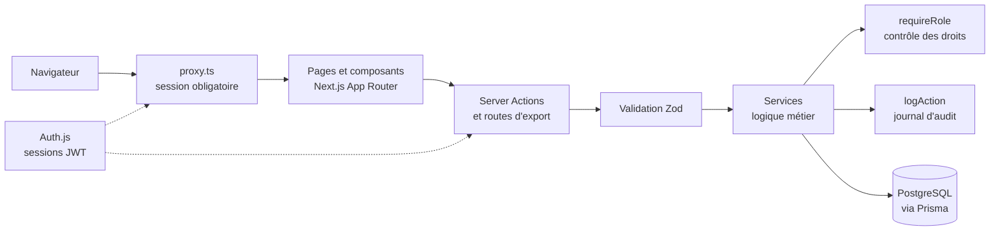
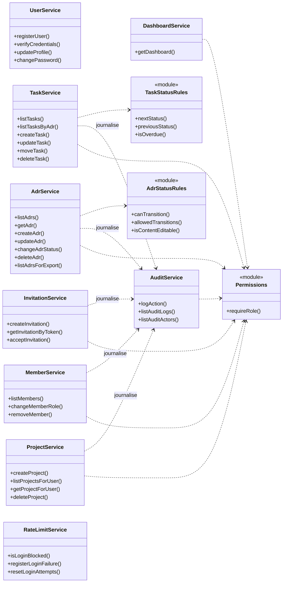

# Architecture de SlamGement

## Vue d'ensemble

Chaque requête traverse les mêmes couches. La règle d'or : les pages et les
actions serveur ne parlent **jamais** directement à la base, elles passent par
un service, et c'est le service qui contrôle les droits et journalise.

## Diagramme de classes de la couche métier

## Modèle de données

Le modèle relationnel est dans `prisma/schema.prisma`. Les tables : `User`,
`Project`, `Membership` (rôle par projet), `Invitation`, `Adr`, `Task`,
`AuditLog`, `RateLimit`.

## Décisions d'architecture (les ADR du projet lui-même)

| Décision                                                                     | Raison                                                                                                  |
| ---------------------------------------------------------------------------- | ------------------------------------------------------------------------------------------------------- |
| Règles métier dans des modules sans dépendance (`adr-status`, `task-status`) | Testables seules, réutilisées par l'interface et les services                                           |
| Contrôle des droits dans les services, jamais seulement dans l'interface     | Cacher un bouton ne protège rien                                                                        |
| Action et trace d'audit dans la même transaction                             | Jamais de changement sans trace                                                                         |
| Pas d'adaptateur Prisma pour Auth.js, sessions JWT                           | Notre modèle `User` porte déjà `passwordHash` ; le fournisseur Credentials impose le JWT                |
| Markdown sans HTML brut, Mermaid en mode strict                              | Protection contre le XSS                                                                                |
| Service worker limité à la page hors ligne                                   | Aucune donnée privée stockée sur l'appareil                                                             |
| Compteur `adrCounter` par projet, incrémenté atomiquement                    | Un numéro d'ADR n'est jamais réattribué après suppression : les fichiers `.md` exportés restent valides |
| Fuseau `Europe/Paris` fixé à l'affichage (`lib/format.ts`)                   | Le serveur est en UTC : sans cela, les heures affichées auraient 1 à 2 h de décalage                    |
| Polices servies par le paquet `geist`                                        | Aucun appel à Google Fonts au build ni à l'exécution (build reproductible, pas de transfert d'IP)       |
