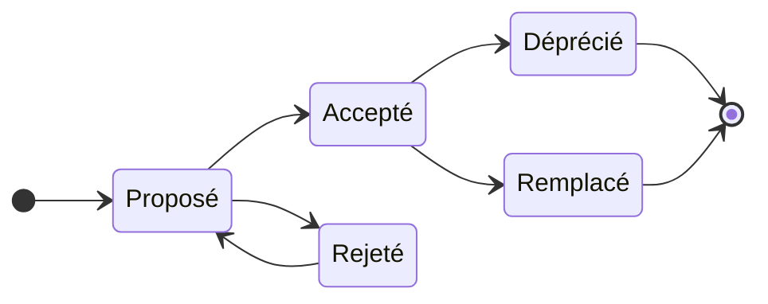

# Manuel utilisateur de SlamGement

SlamGement aide une équipe à **organiser son travail** (un tableau Kanban) et à
**garder la trace de ses décisions techniques** (les ADR). Tout est relié : une
tâche peut renvoyer à la décision qu'elle met en œuvre.

## 1. À savoir avant de commencer

### Qu'est-ce qu'un ADR ?

Un ADR (_Architecture Decision Record_) est une courte note qui documente **une
décision technique** : le contexte, ce qui a été décidé, les conséquences, et
les alternatives étudiées. Quand quelqu'un demande dans six mois « pourquoi
a-t-on choisi cette base de données ? », la réponse est écrite.

### Les deux rôles

Le rôle est défini **par projet** : on peut être administrateur d'un projet et
simple membre d'un autre.

| Action                                                  | Membre | Administrateur                         |
| ------------------------------------------------------- | ------ | -------------------------------------- |
| Voir le projet, les ADR, les tâches, le tableau de bord | ✔      | ✔                                      |
| Créer et modifier un ADR, changer son statut            | ✔      | ✔                                      |
| Créer, modifier, déplacer, supprimer une tâche          | ✔      | ✔                                      |
| Exporter un ADR ou tous les ADR                         | ✔      | ✔                                      |
| Quitter le projet                                       | ✔      | ✔ (s'il reste un autre administrateur) |
| Inviter, changer un rôle, retirer un membre             | ✘      | ✔                                      |
| Supprimer un ADR                                        | ✘      | ✔                                      |
| Consulter l'historique des actions                      | ✘      | ✔                                      |
| Supprimer le projet                                     | ✘      | ✔                                      |

Un projet a toujours **au moins un administrateur**.

### Les statuts d'un ADR

| Statut       | Signification                      | Modifiable ?                          |
| ------------ | ---------------------------------- | ------------------------------------- |
| **Proposé**  | La décision est en discussion      | Oui                                   |
| **Accepté**  | La décision est prise              | Non                                   |
| **Rejeté**   | La proposition est écartée         | Non (peut être remise en proposition) |
| **Déprécié** | La décision n'est plus d'actualité | Non, statut final                     |
| **Remplacé** | Une autre décision la remplace     | Non, statut final                     |



Pourquoi ne peut-on pas modifier un ADR accepté ? Parce qu'il garde la mémoire
d'une décision. Si la situation change, on écrit un **nouvel ADR** qui remplace
l'ancien : l'historique reste lisible.

## 2. Premiers pas

### Créer un compte

1. Ouvre le site et clique sur **Créer un compte**.
2. Renseigne ton nom, ton email et un mot de passe de **8 caractères minimum**.
3. Clique sur **Créer mon compte** : tu arrives sur la page de connexion.


### Se connecter

1. Saisis ton email et ton mot de passe, puis **Se connecter**.
2. Tu arrives sur **Mes projets**.

Après **5 échecs** consécutifs, la connexion est bloquée 15 minutes, même avec
le bon mot de passe. Le message d'erreur reste volontairement vague
(« Identifiants invalides ») : il ne révèle pas si un compte existe.

### Gérer ton profil

Depuis **Mes projets**, clique sur **Mon profil**. Tu peux y changer ton nom, et
ton mot de passe (en saisissant l'ancien). Ton email est affiché mais ne peut
pas être modifié. La session expire d'elle-même au bout de 8 heures.


### Se déconnecter

Le bouton **Se déconnecter** se trouve sur la page **Mes projets**.

### Installer l'application

- **Sur ordinateur (Chrome ou Edge)** : une icône d'installation apparaît dans la
  barre d'adresse. SlamGement s'ouvre alors dans sa propre fenêtre.
- **Sur téléphone** : dans le menu du navigateur, choisis « Ajouter à l'écran
  d'accueil » ou « Installer l'application » (nécessite que le site soit servi
  en HTTPS).

L'application ne fonctionne **pas hors ligne** : sans connexion, elle affiche une
page « Tu es hors ligne ». C'est voulu, aucune donnée n'est conservée sur ton
appareil.

## 3. Les projets

### Créer un projet

Sur **Mes projets**, remplis **Nouveau projet** (un nom, une description
facultative) et clique sur **Créer le projet**. Tu en deviens
**administrateur**.


### Naviguer dans un projet

Une barre de navigation en haut de chaque page du projet donne accès à :
**Accueil**, **Tableau de bord**, **Décisions (ADR)**, **Kanban**, **Membres**
et, pour les administrateurs, **Historique**. Sur téléphone, elle défile
horizontalement.

### Supprimer un projet (administrateur)

Sur la page **Accueil** du projet, la **Zone dangereuse** demande de retaper le nom
du projet. La suppression est **définitive** : membres, invitations, ADR et
tâches disparaissent. Seule la trace de la suppression reste dans l'historique
interne.

## 4. Les membres

La page **Membres** liste les personnes du projet et leur rôle.

### Inviter quelqu'un (administrateur)

1. Dans **Inviter un collaborateur**, saisis l'**email** de la personne et choisis son rôle.
2. Clique sur **Créer le lien d'invitation**.
3. **Copie le lien affiché et transmets-le** à la personne. Il n'est affiché qu'une seule fois.

Le lien est valable **7 jours**, ne fonctionne **qu'une seule fois**, et seul le
compte portant **cet email** peut l'utiliser. La personne ouvre le lien,
se connecte (ou crée un compte avec la même adresse), puis clique sur
**Rejoindre le projet**.


### Changer un rôle, retirer ou quitter

- **Administrateur** : choisis le rôle dans la liste puis clique sur **Appliquer** ; **Retirer** exclut la personne.
- **Tout le monde** : **Quitter** sur ta propre ligne.
- Le dernier administrateur ne peut ni quitter le projet, ni être rétrogradé. Nomme d'abord un autre administrateur.

## 5. Les décisions d'architecture (ADR)

### Lire la liste

**Décisions (ADR)** affiche un tableau (numéro, titre, statut, auteur, date). Les
boutons **Tous / Proposé / Accepté…** filtrent par statut. Le numéro est
attribué automatiquement dans le projet : ADR-0001, ADR-0002…


### Créer un ADR

1. Clique sur **Nouvel ADR**.
2. Remplis **Titre**, **Contexte**, **Décision** et **Conséquences** (10 caractères
   minimum pour les trois champs de texte). **Alternatives étudiées** et
   **Schéma Mermaid** sont facultatifs.
3. À droite, un **aperçu** se met à jour pendant que tu écris.
4. Clique sur **Créer l'ADR** : il démarre au statut **Proposé**.

Les textes acceptent le **Markdown** (gras, listes, tableaux, code). Le HTML brut
n'est pas interprété, et les images distantes sont bloquées.

### Ajouter un schéma

Dans **Schéma Mermaid**, écris du code Mermaid, par exemple :

```
graph TD
  Navigateur --> Application
  Application --> Base[(PostgreSQL)]
```

Le schéma se dessine dans l'aperçu après une courte pause. Si le code est
invalide, un message l'indique sans bloquer le formulaire.


### Faire vivre un ADR

Sur la page d'un ADR, les boutons proposés dépendent de son statut :

| Statut actuel      | Boutons disponibles                       |
| ------------------ | ----------------------------------------- |
| Proposé            | **Accepter**, **Rejeter**, **Modifier**   |
| Rejeté             | **Remettre en proposition**               |
| Accepté            | **Déprécier**, **Marquer comme remplacé** |
| Déprécié, Remplacé | aucun (statut final)                      |

**Remplacer une décision** : sur l'ADR accepté, saisis le **numéro de l'ADR
remplaçant** puis clique sur **Marquer comme remplacé**. Le remplaçant ne doit
pas être rejeté, et un ADR ne peut en remplacer qu'un seul. Les deux pages
affichent ensuite un lien l'une vers l'autre.


### Exporter

- **Exporter .md** (sur la page d'un ADR) télécharge un fichier Markdown prêt à
  déposer dans un dépôt Git, avec le schéma dans un bloc `mermaid` que GitHub
  et GitLab affichent directement.
- **Tout exporter (ZIP)** (sur la liste) rassemble tous les ADR du projet,
  avec les liens de remplacement entre les fichiers.

### Supprimer (administrateur)

En bas de la page d'un ADR : coche la case de confirmation puis **Supprimer
l'ADR**. Impossible si cet ADR en remplace un autre. Les tâches liées restent,
simplement sans lien.

## 6. Le tableau Kanban

Le tableau a **quatre colonnes** : À faire, En cours, Revue, Terminé.

### Créer une tâche

Déplie **Nouvelle tâche** et renseigne un titre (obligatoire), une description en
Markdown, une **échéance**, la personne **assignée** (un membre du projet), et
éventuellement la **décision liée** (un ADR du projet). La tâche arrive dans
**À faire**.


### Déplacer une carte

Chaque carte a un bouton **← colonne précédente** et un bouton **colonne
suivante →**. Il n'y a pas de bouton au-delà de la première et de la dernière colonne.

### Lire une carte

- **Modifier** ouvre la tâche pour la changer ou la supprimer.
- La **description** se déplie.
- Une échéance dépassée s'affiche en rouge avec la mention **(en retard)**. Une tâche **Terminée** n'est jamais en retard.
- Le lien **ADR-000X** renvoie à la décision liée ; en sens inverse, la page de l'ADR liste ses **tâches liées**.

### Filtrer

Choisis un **membre** (ou **Non assignées**) et/ou une **colonne**, puis **Filtrer**.
L'adresse de la page contient le filtre : tu peux la partager ou la recharger.

## 7. Suivre l'avancement

### Le tableau de bord

Il présente quatre compteurs (décisions, tâches, tâches en retard, membres), la
répartition des **ADR par statut** et des **tâches par colonne**, et surtout :

- **Décisions acceptées sans tâche liée** : des décisions prises dont la mise en œuvre
  n'est peut-être pas planifiée ;
- l'**activité récente** du projet.


### L'historique (administrateur)

**Historique** liste toutes les actions du projet en phrases lisibles (« a fait
passer ADR-0001 de Proposé à Accepté »). On peut filtrer par **utilisateur**, par
**action** et par **période** ; la liste est paginée. Chaque action et sa trace sont
enregistrées ensemble : il n'existe pas de modification sans trace.


## 8. Problèmes fréquents

| Situation                                              | Explication et solution                                                                       |
| ------------------------------------------------------ | --------------------------------------------------------------------------------------------- |
| « Trop de tentatives » à la connexion                  | 5 échecs ont été comptés. Attends 15 minutes                                                  |
| J'ai oublié mon mot de passe                           | La réinitialisation n'existe pas encore. Contacte la personne qui administre le site          |
| Le lien d'invitation est « invalide ou expiré »        | Il a déjà servi, ou date de plus de 7 jours. Demande-en un nouveau à un administrateur        |
| « Cette invitation est destinée à… »                   | Tu es connecté avec un autre compte. Déconnecte-toi et utilise l'adresse invitée              |
| Je ne peux plus modifier mon ADR                       | Il n'est plus au statut Proposé. Écris un nouvel ADR qui le remplace                          |
| Je ne peux pas quitter le projet                       | Tu en es le dernier administrateur. Nomme-en un autre d'abord                                 |
| Je n'ai pas le formulaire d'invitation ni l'historique | Ces fonctions sont réservées aux administrateurs                                              |
| La page d'un projet affiche « 404 »                    | Le projet n'existe pas, ou tu n'en es pas membre (les deux cas se ressemblent volontairement) |
| Un schéma ne s'affiche pas                             | Le code Mermaid est invalide : le message sous l'aperçu indique la ligne en cause             |
| « Tu es hors ligne »                                   | Reconnecte-toi à Internet puis clique sur **Réessayer**                                       |

## Annexe : captures d'écran à prendre

Prends-les sur le jeu de démonstration (`npm run db:seed`), connecté en
`alice@slamgement.test`, avec un navigateur à une largeur d'environ 1280 px.

| Fichier                  | Écran                  | Remarque                                           |
| ------------------------ | ---------------------- | -------------------------------------------------- |
| `01-inscription.png`     | Page d'inscription     | Avant de remplir                                   |
| `02-profil.png`          | Page de profil         |                                                    |
| `03-projets.png`         | Mes projets            |                                                    |
| `04-membres.png`         | Membres                | En administrateur, formulaire d'invitation visible |
| `05-adr-liste.png`       | Liste des ADR          | Plusieurs statuts visibles                         |
| `06-adr-formulaire.png`  | Formulaire avec aperçu | Texte Markdown et schéma remplis                   |
| `07-adr-detail.png`      | ADR n° 3               | Schéma, tâches liées, boutons                      |
| `08-kanban.png`          | Tableau Kanban         | Les quatre colonnes remplies                       |
| `09-tableau-de-bord.png` | Tableau de bord        | Une tâche en retard visible                        |
| `10-historique.png`      | Historique             |                                                    |

Enregistre-les dans `docs/images/`. Ajoutes-en une version mobile (outils de
développement, mode appareil, 375 px) pour la liste des ADR et le Kanban.
